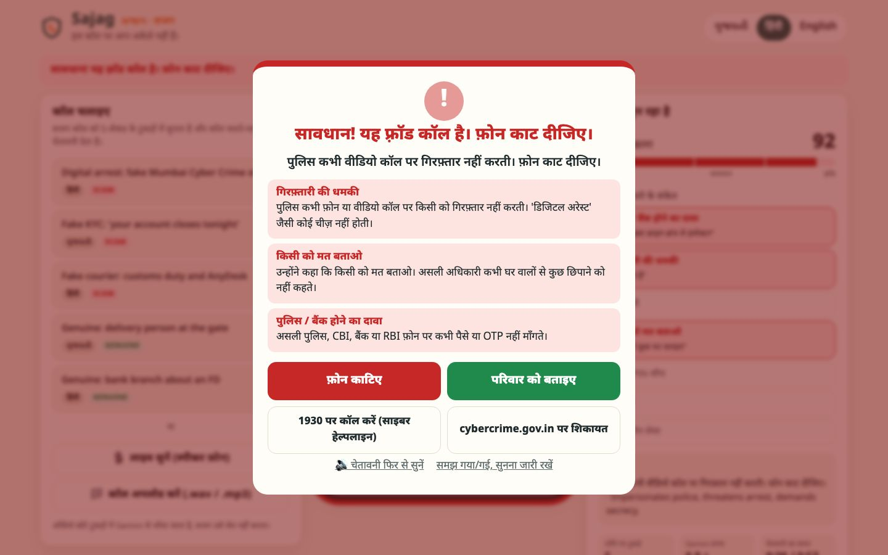
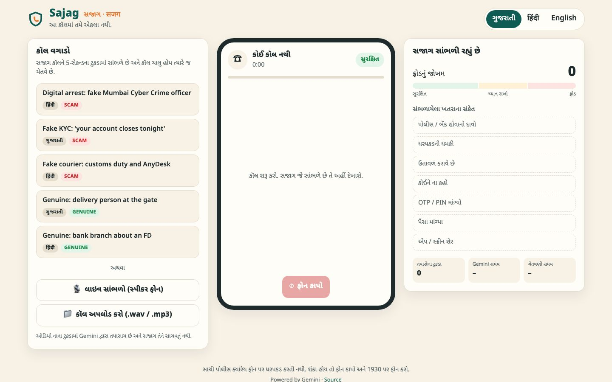
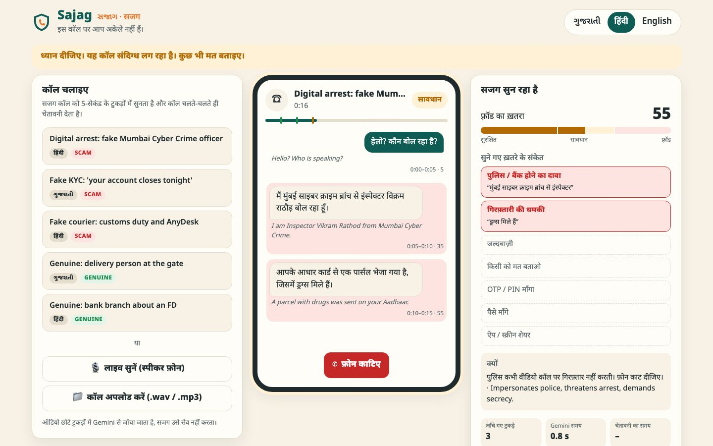
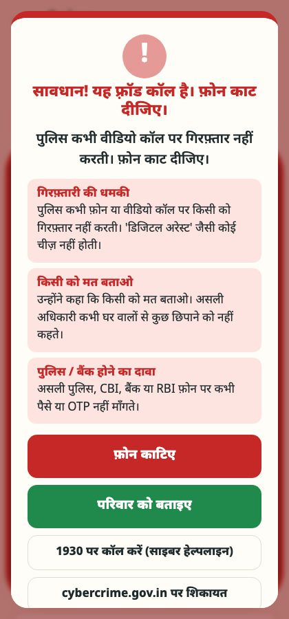
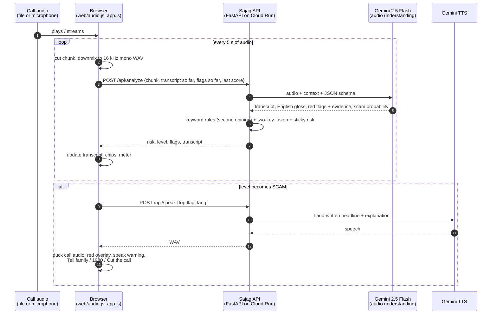

<div align="center">


# Sajag · સજાગ · सजग

**A guardian that listens to the call with you, and warns you the moment it sounds like a scam.**

It hears Gujarati, Hindi and English, flags "digital arrest", fake KYC and fake courier calls *while the call is still going*,
and explains why in the listener's own language, out loud:
*"પોલીસ ક્યારેય વિડિયો કૉલ પર કોઈની ધરપકડ કરતી નથી. ફોન કાપી નાખો."*

Powered by **Gemini** (audio understanding + speech generation). Built to run on **Google Cloud Run**.

**Challenge:** Voice AI Scam Shield

</div>

<p align="center">
  
</p>

## ⏱️ For judges: the 2-minute tour

| | |
|---|---|
| **What** | A second listener on the phone call. It hears Gujarati and Hindi, spots a scam *while the call is still going*, and warns out loud, in the listener's language, with the reasons. |
| **Why it matters** | Digital-arrest, fake KYC and fake courier scams work because the victim is alone on the call. Sajag makes sure they aren't. |
| **How** | The call is cut into 5-second pieces → **Gemini 2.5 Flash** listens to each one (audio in, no browser speech-to-text) → structured verdict with red flags and evidence → a two-key risk model → a spoken warning from **Gemini TTS**. |
| **Proof it doesn't cry wolf** | Two genuine calls (a delivery person, a bank branch that even says "OTP") are in the samples and in the tests. |
| **Try it** | `cp .env.example .env` (add a Gemini key) → `uv sync` → `uv run uvicorn app.main:app` → open `localhost:8000` → click a sample call. |
| **Read more** | [How it works](#4-how-it-works) · [Red flags](#5-the-red-flags) · [Two-key model](#6-not-crying-wolf-the-two-key-risk-model) · [Architecture](docs/ARCHITECTURE.md) · [Demo script](docs/DEMO.md) |

### Screens

| 1 · Pick a call (Gujarati UI) | 2 · Listening mid-call (Hindi) |
|---|---|
|  |  |
| **3 · Scam confirmed: the warning takes over** | **4 · Same warning on a phone** |
|  |  |

<sub>Screens 2–4 were captured from the UI test harness, which stands in for Gemini with scripted verdicts so the flow
can be shown deterministically. The latency and risk numbers in them are illustrative. Run the app with a key, or
`scripts/evaluate.py`, for real results.</sub>

---

## Contents

1. [The problem](#1-the-problem)
2. [What Sajag does](#2-what-sajag-does)
3. [Demo in 60 seconds](#3-demo-in-60-seconds)
4. [How it works](#4-how-it-works)
5. [The red flags](#5-the-red-flags)
6. [Not crying wolf: the two-key risk model](#6-not-crying-wolf-the-two-key-risk-model)
7. [Sample calls](#7-sample-calls)
8. [Run it locally](#8-run-it-locally)
9. [Deploy to Cloud Run](#9-deploy-to-cloud-run)
10. [Evaluation](#10-evaluation)
11. [Privacy, safety and security](#11-privacy-safety-and-security)
12. [Limitations and roadmap](#12-limitations-and-roadmap)
13. [Project layout](#13-project-layout)
14. [Credits](#14-credits)

More detail: [Architecture](docs/ARCHITECTURE.md) · [Demo runbook and pitch](docs/DEMO.md) · [Evaluation method](docs/EVALUATION.md)

---

## 1. The problem

"Digital arrest", fake KYC and fake courier calls cost Indians thousands of crores a year. They follow one script:

1. **Borrow authority.** "I am Inspector Rathod, Mumbai Cyber Crime." "I am calling from your bank's KYC department."
2. **Create fear.** "A parcel with drugs was sent on your Aadhaar." "Your account closes tonight."
3. **Isolate.** "You are under digital arrest. Keep the video call on. Don't tell your family."
4. **Extract.** "Read me the OTP." "Move your savings to the RBI verification account." "Install AnyDesk."

Elders and first-time smartphone users are hit hardest, and **the scam works because the victim is alone on the call.**
Nobody is there to say "wait, police don't do that".

## 2. What Sajag does

Sajag is that second person on the call.

| | |
|---|---|
| 👂 **Listens in 5-second pieces** | The call is cut into short chunks and each is sent to Gemini as it is heard, so the warning lands mid-call, not after the money is gone. |
| 🧠 **Understands, not just transcribes** | Gemini hears colloquial Gujarati, Hindi and Hinglish directly from audio (no browser speech-to-text), keeps the whole conversation in context and judges *the call*, not single words. |
| 🚩 **Names the red flags** | Authority claim, arrest threat, urgency, secrecy, OTP request, money request, remote-access app. Each with the caller's exact words as evidence. |
| 🗣️ **Explains in plain language** | One true, simple sentence per red flag in ગુજરાતી / हिंदी / English, and a spoken warning generated by Gemini TTS. |
| 🛡️ **Doesn't cry wolf** | A genuine delivery call and a genuine bank call (which literally says "OTP") stay green. See [the two-key model](#6-not-crying-wolf-the-two-key-risk-model). |
| 👨‍👩‍👧 **Breaks the isolation** | One tap to "Tell my family" on WhatsApp, call the national cyber-fraud helpline **1930**, or report at cybercrime.gov.in. |

## 3. Demo in 60 seconds

```bash
cp .env.example .env            # add your GEMINI_API_KEY
uv sync
uv run uvicorn app.main:app --reload
# open http://localhost:8000 and click "Digital arrest: fake Mumbai Cyber Crime officer"
```

What you will see:

1. The call plays. The transcript appears in Devanagari or Gujarati script, chunk by chunk, with an English gloss.
2. Around the second or third sentence, the red-flag chips light up with the caller's exact words: *"मुंबई साइबर क्राइम ब्रांच से इंस्पेक्टर"*.
3. The risk meter crosses 70. The call audio ducks, the screen turns red and Sajag says, in the chosen language:
   *"सावधान! यह फ़्रॉड कॉल है। फ़ोन काट दीजिए। पुलिस कभी वीडियो कॉल पर गिरफ़्तार नहीं करती।"*
4. The **Warned at** stat shows how early it caught it (for example `0:20 / 0:57`). The call is still running.
5. Play **Genuine: delivery person at the gate**. It also talks about a parcel and a payment. Sajag stays green.

Use **Listen live** to put a real phone on speaker next to the laptop. Full presenter runbook: [docs/DEMO.md](docs/DEMO.md).

## 4. How it works



Key decisions:

- **End-to-end audio model, not browser speech recognition.** The Web Speech API struggles with colloquial Gujarati and
  Hindi and code-mixing. Gemini takes the raw audio and returns the transcript, the translation and the judgement in one
  call, so nothing is lost in a separate speech-to-text step.
- **Chunks of 5 seconds, analysed strictly in order.** Short enough that the warning lands mid-call; long enough that a
  chunk carries a full phrase. Each request carries the transcript of everything before it, so Gemini judges the whole
  conversation, not a 5-second fragment.
- **Stateless server.** The browser holds the call state and sends it with each chunk. The server stores nothing, scales
  to zero on Cloud Run and needs no database or sticky sessions.
- **Structured output.** Gemini answers against a strict JSON schema with a fixed red-flag enum. No free-text parsing.
- **Low latency.** Thinking is turned down for the flash model so each chunk comes back well inside its 5-second budget.
  The UI shows the measured Gemini latency live, and `scripts/evaluate.py` reports it per call.

Deep dive, including the full prompt, schema, latency budget and failure modes: [docs/ARCHITECTURE.md](docs/ARCHITECTURE.md).

## 5. The red flags

| Code | What the caller does | What Sajag tells the listener (English; also in Gujarati and Hindi) |
|---|---|---|
| `AUTHORITY` | Claims to be police, CBI, customs, cyber crime, RBI, a court, a bank's KYC department | Real police, CBI, banks or RBI never ask for money or an OTP over a phone call. |
| `ARREST_THREAT` | Arrest, warrant, jail, "digital arrest", drugs, money laundering | Police never arrest anyone over a phone or video call. There is no such thing as a "digital arrest". |
| `URGENCY` | "Right now", "within an hour", "your account closes tonight" | They are rushing you so you cannot think. Real officials always give you time. |
| `SECRECY` | "Don't tell your family", "keep the video call on", "don't hang up" | A real officer never asks you to hide anything from your family. |
| `OTP_REQUEST` | Asks for OTP, PIN, CVV, password, card number | Never tell anyone your OTP, PIN or CVV on a call, not even someone who says they are from the bank. |
| `MONEY_REQUEST` | Transfer money, pay a fee/fine/duty, "safe" or "verification" account | No government office asks you to transfer money to "verify" or "clear" your name. |
| `REMOTE_ACCESS` | Install AnyDesk/TeamViewer, share screen, click a link | Apps like AnyDesk or screen sharing hand your phone and bank to the caller. |

The explanations are **written by hand, not generated**, in [`app/redflags.py`](app/redflags.py), so the advice an elder
hears is always correct. Gemini picks *which* red flags apply and quotes the evidence; it never writes the advice. That
also means a scammer can't steer what Sajag tells the user.

## 6. Not crying wolf: the two-key risk model

A guardian that shouts at every courier call gets switched off. Sajag combines two opinions:

1. **Gemini** (primary): hears tone, context and negation. It knows "never share your OTP" is advice, not a request.
2. **Keyword rules** (second opinion): deterministic patterns in Gujarati, Devanagari and English, run on both the
   original transcript and Gemini's English gloss. They catch a flag the model under-reports.

The fusion, in [`app/risk.py`](app/risk.py):

```
model   = max(gemini_probability, previous_model - 10)        # sticky: a scam call doesn't become safe in one quiet chunk
rules   = min(100, Σ weight(flag) for every distinct flag seen)
risk    = max(model, (model + rules) / 2)
if (AUTHORITY or ARREST_THREAT) and (OTP or MONEY or REMOTE_ACCESS):
    risk = max(risk, 85 if model ≥ 40 else 40)                # the classic scam combo: SCAM if the model agrees, else CAUTION
level   = SCAM ≥ 70 · CAUTION ≥ 40 · SAFE
```

- **Gemini alone can raise the alarm.**
- **Rules alone cannot.** They can push a call to *Careful* but never to *Scam* unless Gemini agrees it is at least
  suspicious. That is the "two keys".
- **But rules can't be silenced either.** If the classic combo is heard and Gemini disagrees (for example because a
  caller tried to talk the AI down), the call still goes amber: "Careful. Do not share anything."

The genuine bank call in the samples says *"बैंक कभी फ़ोन पर OTP या PIN नहीं माँगता"*. The keyword layer sees "OTP";
the two-key rule keeps it green. This exact case is a unit test (`tests/test_redflags.py`).

## 7. Sample calls

Five scripted calls in [`samples/`](samples/), with their scripts in [`samples/scripts/`](samples/scripts/):

| File | Language | Truth | What happens in the call |
|---|---|---|---|
| `01_digital_arrest_hi.wav` | Hindi | Scam | Fake "Mumbai Cyber Crime" inspector, drugs parcel on your Aadhaar, digital arrest, secrecy, move savings to an "RBI verification account". |
| `02_fake_kyc_gu.wav` | Gujarati | Scam | Fake bank KYC agent, pension account "closes tonight", asks for the OTP and the card's CVV. |
| `03_fake_courier_hi.wav` | Hindi | Scam | Fake international courier, parcel stuck at customs, pay duty today or face a case, install AnyDesk, enter UPI PIN. |
| `04_genuine_delivery_gu.wav` | Gujarati | Genuine | A real delivery person at the society gate. Mentions a parcel and payment, asks for nothing sensitive. |
| `05_genuine_bank_hi.wav` | Hindi | Genuine | A real bank branch about a maturing FD. Says "bank" and "OTP" (as a warning). |

All names, numbers and organisations in the scripts are fictional. Regenerate the audio at any time:

```bash
uv run python scripts/generate_calls.py              # Gemini multi-speaker TTS (natural voices) when a key is set
uv run python scripts/generate_calls.py --engine say # offline fallback with the macOS Hindi voice
```

The Gemini engine voices each speaker separately (a stern "officer", a frightened elder) from the `speakers` block in
each script. To add a call, drop a new JSON script in `samples/scripts/` and run the generator. It shows up in the UI
automatically.

## 8. Run it locally

Requirements: Python 3.11–3.13 and [uv](https://docs.astral.sh/uv/) (or plain `pip`), and a Gemini API key from
[Google AI Studio](https://aistudio.google.com/apikey).

```bash
git clone https://github.com/VedantDomadiya/sajag.git && cd sajag
cp .env.example .env                       # then put your key in .env (it is gitignored)
uv sync                                    # installs fastapi, uvicorn, google-genai (+ pytest for dev)
uv run uvicorn app.main:app --reload       # http://localhost:8000
```

Without uv: `python -m venv .venv && . .venv/bin/activate && pip install fastapi "uvicorn[standard]" google-genai`.

| Variable | Default | Purpose |
|---|---|---|
| `GEMINI_API_KEY` | (required) | Gemini API key. Server-side only, never sent to the browser. |
| `SAJAG_MODEL` | `gemini-2.5-flash` | Model for audio understanding. Any Gemini model with audio input works. |
| `SAJAG_TTS_MODEL` | `gemini-2.5-flash-preview-tts` | Model for the spoken warning and sample generation. |
| `SAJAG_TTS_VOICE` | `Sulafat` | Prebuilt voice for the warning (warm, calm). |

Checks:

```bash
uv run pytest -q                          # 27 tests: rules, fusion, API contract, input validation, security (no key needed)
uv run python scripts/evaluate.py         # replays every sample through Gemini and reports accuracy + time to warning
```

API (interactive docs at `/api/docs`):

| Method | Path | Purpose |
|---|---|---|
| `POST` | `/api/analyze` | Analyse one chunk: `{audio_b64, mime, lang, t_start, t_end, state}` → risk, level, flags, transcript, warning |
| `POST` | `/api/speak` | Speak the warning with Gemini TTS: `{lang, flag}` → `audio/wav`. Only hand-written text is spoken. |
| `GET` | `/api/samples` | The sample calls |
| `GET` | `/api/meta` | Red-flag labels, explanations and headlines in all three languages |
| `GET` | `/api/health` | Model names and whether a key is configured |

## 9. Deploy to Cloud Run

The app is a single stateless container ([`Dockerfile`](Dockerfile), non-root, port 8080).

```bash
gcloud services enable run.googleapis.com secretmanager.googleapis.com cloudbuild.googleapis.com
printf %s "$GEMINI_API_KEY" | gcloud secrets create gemini-api-key --data-file=-
gcloud run deploy sajag --source . --region asia-south1 --allow-unauthenticated \
  --set-secrets GEMINI_API_KEY=gemini-api-key:latest \
  --memory 512Mi --cpu 1 --min-instances 0 --max-instances 3 --concurrency 20
```

- `asia-south1` (Mumbai) keeps latency low for Indian users.
- The key lives in **Secret Manager**, never in the image or the repo. Grant the Cloud Run service account
  `roles/secretmanager.secretAccessor` on the secret if the deploy asks.
- `--max-instances 3` caps cost on a public demo. Scale-to-zero means it costs nothing when idle.
- Microphone access needs HTTPS, which Cloud Run provides.

## 10. Evaluation

[`scripts/evaluate.py`](scripts/evaluate.py) replays every sample through exactly the pipeline the browser uses (5-second
chunks, in order, with context, Gemini + rules + fusion) and reports, per call: the final verdict, whether it is
correct, **when the warning fired relative to the call length**, the red flags found and the average Gemini latency.
It writes everything, including the per-chunk risk timeline, to `eval-results.json`.

What "good" means, and how to read the results: [docs/EVALUATION.md](docs/EVALUATION.md).

## 11. Privacy, safety and security

- **No recording is kept.** Audio chunks go from the browser to the Sajag server to Gemini and are discarded. The
  server has no database and writes no audio or transcripts to disk or logs.
- **Be transparent with users.** Audio is processed by the Gemini API under Google's terms. A production build would
  show this on first use and use a paid tier/Vertex AI where prompts are not used for training.
- **The key stays server-side.** The browser never sees `GEMINI_API_KEY`. `.env` is gitignored; in the cloud it comes
  from Secret Manager.
- **Input is validated.** Allowed audio types only, base64 checked, chunk size capped (~15 s), language and timestamps
  bounded, client-sent state length-limited. Model output is rendered with `textContent`, never as HTML.
- **Prompt injection.** The caller is an adversary, and anything said on the call reaches the model. The transcript is
  passed inside delimited `<previous_transcript>` tags marked as untrusted data, the system prompt tells Gemini never to
  follow instructions heard in the call and to treat any attempt to address "the AI" as a scam signal, and the keyword
  combo can still force *Careful* even if the model is talked down.
- **No free proxy to the key, and no model text read aloud.** `/api/speak` only speaks hand-written text: the fixed
  headline plus the curated explanation for one red-flag code. No model-written text is shown or spoken; the only model
  output on screen is the transcript and the quoted evidence. Both API routes are rate limited per client (40 analyses
  and 6 speeches a minute) and by a shared per-endpoint cap that, when spent, refuses only clients above a fair share, under a hard ceiling no
  client can pass. Set a budget alert on the Google Cloud project too.
- **Errors don't leak.** Upstream failures are logged on the server; the browser gets a generic message.
- **Headers.** `X-Content-Type-Options: nosniff`, a strict `Referrer-Policy`, and a `Permissions-Policy` that allows
  only the microphone.
- **Advice is curated.** What the elder reads in the red-flag explanations is fixed, reviewed text, not model output.
- **Sajag assists; it does not decide.** It never hangs up on its own. The person stays in control.

## 12. Limitations and roadmap

Honest limits today:

- A web demo can't sit *inside* a phone call. Live mode listens through the laptop microphone with the phone on speaker.
- Chunks are cut on fixed 5-second boundaries, so a word can be split across two chunks. Context usually repairs it.
- Five scripted samples prove the flow, not field accuracy. Real-world calls are noisier and more varied.

Next:

1. **Android app** using call screening and an accessibility-friendly overlay, so the warning appears on top of the
   real call.
2. **Gemini Live API** streaming instead of fixed chunks, for sub-second reaction and natural turn boundaries.
3. **On-device first pass** (Gemini Nano) so most audio never leaves the phone; escalate only suspicious calls.
4. **Real family alerts**: a push to a registered family member's phone, with the transcript, when a call goes red.
5. **More languages**: Marathi, Tamil, Telugu, Bengali, Punjabi.
6. **Caller reputation**: combine with reported-number lists (Sanchar Saathi / Chakshu) where available.

## 13. Project layout

```
app/
  main.py          FastAPI app: routes, validation, static files, security headers
  analyzer.py      Gemini audio call: system prompt, JSON schema, retry
  redflags.py      Red-flag taxonomy, weights, keyword rules, hand-written explanations (gu/hi/en)
  risk.py          Two-key fusion, sticky risk, thresholds
  speech.py        Gemini TTS for the spoken warning; WAV and resampling helpers
  config.py        Environment and .env loading
web/
  index.html       Single page: sources, phone, guardian panel, warning overlay
  audio.js         File/mic capture, 5 s chunking, 16 kHz WAV encoding
  app.js           Call lifecycle, ordered analysis queue, rendering, warning, TTS
  i18n.js          UI strings in Gujarati, Hindi, English
  style.css        Elder-friendly, high-contrast styles (light and dark)
samples/           Five .wav calls + their JSON scripts
scripts/
  generate_calls.py  Build the sample .wav files (Gemini multi-speaker TTS or macOS fallback)
  evaluate.py        Replay all samples through the real pipeline and score them
tests/             Rules, fusion and API tests (no API key needed)
docs/              Architecture, demo runbook, evaluation method
Dockerfile         Cloud Run container
```

## 14. Credits

- **Google Gemini**: `gemini-2.5-flash` for audio understanding, `gemini-2.5-flash-preview-tts` for the spoken warning
  and the sample calls. **Google Cloud Run** for hosting.
- FastAPI, Uvicorn and the `google-genai` SDK. Noto Sans fonts (Google Fonts) for Gujarati and Devanagari.
- Developed with Claude Code as an AI coding assistant.
- Helplines in the app: **1930** (National Cyber Crime Helpline) and **cybercrime.gov.in**.

Licensed under the [MIT License](LICENSE).

> If you or someone you know gets a call like this: **cut the call, call family, call 1930.**
> Real police never arrest anyone over a video call.
