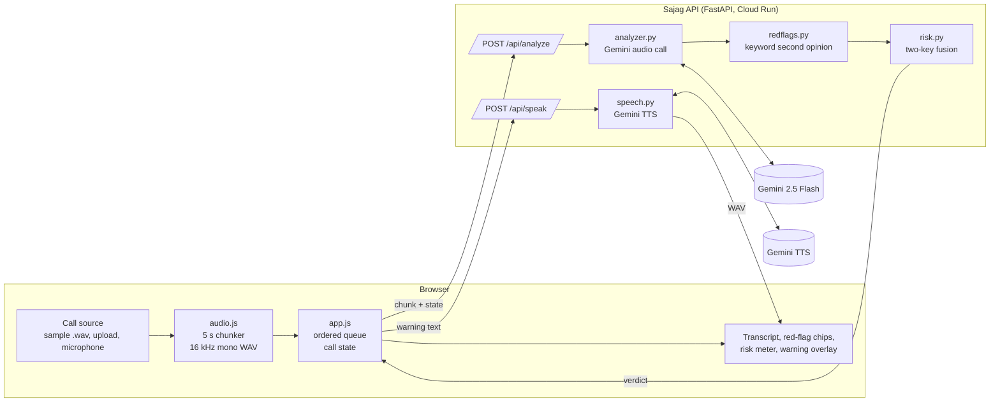

# Architecture

This document explains how Sajag turns a phone call into a mid-call warning, why each piece is designed the way it is,
and what happens when things go wrong. Start with the [README](../README.md) for the overview.

## 1. Components



| Piece | File | Responsibility |
|---|---|---|
| Chunker | `web/audio.js` | Plays a file or taps the mic; emits a chunk every 5 s of *heard* audio; downmixes and resamples to 16 kHz mono 16-bit WAV. |
| Call controller | `web/app.js` | Owns call state; sends chunks strictly in order; renders results; raises the warning once; speaks it. |
| API | `app/main.py` | Validates input, calls the analyzer, adds the rule layer, fuses, returns one verdict. Stateless. |
| Analyzer | `app/analyzer.py` | Builds the Gemini request (audio + context + schema), retries once, cleans the output. |
| Red flags | `app/redflags.py` | Taxonomy, weights, multilingual keyword rules, hand-written explanations and headlines. |
| Risk | `app/risk.py` | Two-key fusion, sticky risk, thresholds. Pure functions, unit-tested. |
| Speech | `app/speech.py` | Gemini TTS for the spoken warning (cached); WAV/resample helpers. |

## 2. Life of a chunk

1. **Capture.** For a file, `FileCall` plays an `AudioBuffer` and every 100 ms checks how much has been *played*. When
   playback passes the next 5-second mark, it slices exactly that window from the decoded buffer. For the microphone,
   `MicCall` accumulates samples from a `ScriptProcessorNode` and flushes every 5 s. Either way, the analysis tracks
   what the listener is hearing right now.
2. **Encode.** Stereo is averaged to mono; a box-filter downsampler brings it to 16 kHz (speech needs no more); samples
   are written as 16-bit PCM WAV, about 160 KB per chunk.
3. **Queue.** Chunks join a FIFO. One request is in flight at a time, so chunk *n* always carries the transcript of
   chunks 1..*n-1*. If Gemini is slower than real time the queue grows briefly and drains; nothing is dropped.
4. **Request.** `POST /api/analyze` with the base64 audio, the language for the warning, the chunk's time window and the
   call state: transcript so far, flags so far, last model score.
5. **Gemini.** The system prompt (below) plus a context message (previous transcript, flags already seen, time window)
   plus the audio part. `temperature 0.2`, JSON output constrained by a schema with an enum of flag codes, thinking
   turned down for latency.
6. **Rules.** `match_rules()` runs the keyword patterns over Gemini's original-script transcript *and* its English
   gloss. Any flag Gemini did not report is added with `source: "rules"`.
7. **Fuse.** `risk.fuse()` combines the model score (with decay floor), the rule score and the combo floor into one
   0–100 risk and a level.
8. **Render.** The browser appends the transcript (speaker-labelled bubbles plus the English gloss), lights the chips with
   evidence, moves the meter and drops a coloured marker on the call's progress bar.
9. **Warn (once).** The first time the level is `SCAM`, the call audio ducks to 12%, the overlay opens with the
   headline, Gemini's call-specific warning and the curated explanation for every flag seen, the phone vibrates where
   supported, and the warning is spoken through `/api/speak`.

## 3. The prompt

The full system prompt lives in [`app/analyzer.py`](../app/analyzer.py). Its design choices:

- **Role and audience first.** "A guardian that listens to live phone calls on behalf of elderly and first-time
  smartphone users in India." This frames every later judgement.
- **Transcribe in the original script, label the speaker.** Gujarati script for Gujarati, Devanagari for Hindi, each
  line prefixed `Caller:` or `User:`. Speaker labels matter: only the *caller's* behaviour counts.
- **Judge the whole call, not the chunk.** The previous transcript and flags are provided; the probability is for the
  conversation so far.
- **A closed set of seven flags,** each defined concretely, with an enum in the schema so the model cannot invent codes.
- **Explicit anti-cry-wolf rules.** Don't flag the user's words, advice like "never share your OTP", or ordinary
  requests like a delivery person asking for the address. "Ordinary calls stay below 20. Use 70+ only for clear red
  flags."
- **Evidence in the original language.** Every flag must quote the caller's exact words, which the UI shows.
- **The warning is for an elder.** One or two short sentences, everyday words, in the chosen language, saying what is
  wrong and what to do, with an example in the prompt.

### Response schema

```json
{
  "transcript": "Caller: मैं मुंबई साइबर क्राइम ब्रांच से इंस्पेक्टर ...",
  "english": "I am Inspector ... from Mumbai Cyber Crime Branch ...",
  "flags": [{"code": "AUTHORITY", "evidence": "मुंबई साइबर क्राइम ब्रांच से इंस्पेक्टर"}],
  "scam_probability": 62,
  "scam_type": "DIGITAL_ARREST",
  "warning": "पुलिस कभी वीडियो कॉल पर गिरफ़्तार नहीं करती। फ़ोन काट दीजिए।",
  "reasoning": "Caller impersonates police and introduces a criminal accusation."
}
```

### API response to the browser

```json
{
  "transcript": "...", "english": "...",
  "flags": [{"code": "AUTHORITY", "evidence": "...", "source": "gemini"},
            {"code": "MONEY_REQUEST", "evidence": "…सारा पैसा ट्रांसफर कर…", "source": "rules"}],
  "all_flags": ["AUTHORITY", "MONEY_REQUEST"],
  "risk": 85, "model_risk": 62, "rule_risk": 55, "combo": true, "level": "SCAM",
  "scam_type": "DIGITAL_ARREST", "warning": "...", "warning_token": "<hmac>", "reasoning": "...", "latency_ms": 940
}
```

## 4. Risk fusion

See [`app/risk.py`](../app/risk.py) and the README's [two-key section](../README.md#6-not-crying-wolf-the-two-key-risk-model).

| Constant | Value | Why |
|---|---|---|
| `SCAM_AT` | 70 | Matches the prompt's "70+ only for clear red flags". |
| `CAUTION_AT` | 40 | Amber banner: "Careful. Do not share anything." Cheap to show, useful early. |
| `DECAY` | 10 / chunk | Scammers pause and small-talk. One quiet chunk must not turn a red call green. |
| `COMBO_FLOOR` | 85 | Pretext (authority or arrest) + extraction (OTP, money or remote access) is the signature of all three scam types. |
| `COMBO_NEEDS_MODEL` | 40 | The second key: rules can't trigger the floor unless Gemini finds the call at least suspicious. Without it, the combo still lifts the call to `CAUTION_AT`, so a model that has been talked down can't silence the guardian. |

Flag weights (`redflags.WEIGHTS`): OTP 40, arrest threat 35, money 35, remote access 35, secrecy 30, authority 20,
urgency 15. Authority and urgency are low on purpose: banks and couriers legitimately say who they are and that they're
waiting at the gate.

## 5. Latency budget

| Step | Budget |
|---|---|
| Chunk length (audio must exist before it can be judged) | 5.0 s |
| Encode + upload ~160 KB | < 0.3 s on 4G |
| Gemini flash, audio in, JSON out, thinking off | must stay well under 5 s (measured live in the UI as "Gemini latency") |
| Fusion + render | < 10 ms |

So a red flag spoken at second *t* is on screen by the end of its chunk plus the Gemini latency. The scams in the samples need two or
three sentences before they reveal themselves, so the warning lands while the caller is still talking, and long before
the "transfer the money" step completes.

## 6. Failure modes

| What fails | What happens |
|---|---|
| No `GEMINI_API_KEY` | `/api/analyze` returns 503; the UI shows a clear banner and stops sending chunks. The call keeps playing. |
| Gemini error, timeout, 429 or malformed JSON | One retry with back-off. If it still fails, 502 for that chunk; the UI shows "Retrying…" and continues with the next chunk. Call state is untouched. |
| Gemini slower than real time | The ordered queue grows and drains. Warnings may arrive a little later; nothing is skipped. |
| TTS fails | The browser falls back to its built-in voice to *speak* the warning (this is speech output only; listening is always Gemini). The text overlay is unaffected. |
| A new call starts while chunks are in flight | Responses for the old call are discarded (the controller checks it still owns the state). |
| Oversized or bogus input | 413 / 415 / 400 / 422 before any model call. |

## 7. Security notes

- **Prompt injection.** The caller is the adversary and controls what Gemini hears. Defences: the transcript goes in a
  delimited `<previous_transcript>` block (delimiters stripped from the content) explicitly marked as untrusted data;
  the system prompt forbids following instructions from the call and treats talking to "the AI" as a scam signal;
  the keyword combo independently forces `CAUTION`.
- **Spoken text is server-issued.** `/api/analyze` returns an HMAC `warning_token` over `(lang, warning)`. `/api/speak`
  speaks the fixed headline plus either a warning with a valid token or a curated explanation by flag code, and returns
  403 for anything else. The signing key is derived from the API key, so all instances agree with no extra config.
- **Rate limits.** Per-client sliding window, in memory per instance: 40 `/api/analyze` and 6 `/api/speak` per minute.
  A live call needs 12 analyses a minute. For heavier abuse put Cloud Armor in front and set a billing budget alert.
- **Generic errors.** Upstream exceptions are logged with `log.exception` and the client sees "temporarily unavailable".

- Key server-side only; Secret Manager in production; `.env` gitignored.
- Pydantic models bound every field: audio size (~15 s), MIME allowlist, language enum, timestamps, state length.
- Model output is untrusted text: rendered with `textContent`, never `innerHTML`.
- No audio or transcript persistence; access logs contain paths and status codes only.
- Container runs as a non-root user.
- `Permissions-Policy` allows the microphone and nothing else.
